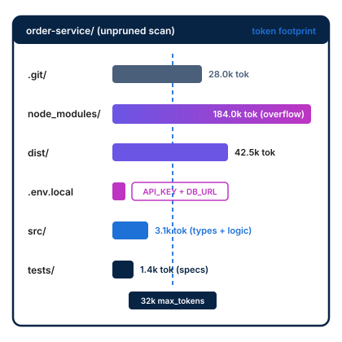

<!-- course-title: Google Antigravity -->
<!-- course-theme: roi-alt-theme -->

<!-- layout: title -->


Google Antigravity

# Chapter 1: Getting Started with Google Antigravity

---

# Chapter 1: Objectives

- Install, authenticate, and configure the Google Antigravity framework in a local development environment
- Understand Google Antigravity architecture and core capabilities for AI development
- Verify prerequisite tooling and install Google Antigravity packages
- Configure authentication and required environment settings for Gemini models
- Walk through live setup and validation of the Antigravity environment

---

<!-- layout: navigation -->
# Chapter 1

- **Google Antigravity Overview and Architecture**
- System Requirements and Installation
- Authentication and Environment Configuration
- Demo: Installing and Configuring Google Antigravity

---

<!-- layout: 2-column -->
# Why AI Coding Workflows Create Friction

### Manual Prompt-and-Paste
- Developers manually copy files and stack traces into browser chat windows
- Models lack awareness of repository structure, dependencies, and types
- Generated snippets require tedious manual merging and formatting
- Team members use inconsistent prompts with no shared configuration

### Google Antigravity Framework
- Connects Gemini models directly to your local repository and toolchain
- Automatically indexes project structure and builds targeted context
- Produces deterministic, reviewable file patches from the CLI or App
- Standardizes model selection and guardrails in versioned configuration

<!-- below-columns -->

> [!NOTE]
> Google Antigravity does not replace your editor or Git workflow - it removes the repetitive wiring between your code and Gemini models.

---

<!-- layout: stacked -->
# Google Antigravity Runtime Architecture

- **Dual entry surfaces**: run fast terminal commands with the Antigravity CLI (`agy`) or inspect workflows visually in the Antigravity App
- **Shared local engine**: a single runtime reads `antigravity.yaml`, indexes the abstract syntax tree (AST), and manages `.antigravity/` session state
- **Bidirectional Gemini loop**: sends pruned project context to Gemini models and applies structured file patches back to your working tree


---

<!-- layout: card-layout -->
# One Framework, Two Complementary Interfaces

### Antigravity CLI (`agy`)
- Built for terminal-first execution, shell pipelines, and automated scripts.
- Generates boilerplate, scaffolds tests, and applies targeted refactors with minimal keystrokes.

### Antigravity App
- Provides a graphical workspace for interactive prototyping and multi-file diff inspection.
- Visualizes context graphs, token budgets, and prompt execution traces side by side.

### Shared Workspace State
- Both interfaces read the same `antigravity.yaml` manifest and local `.antigravity/` state directory.
- Start a task in the terminal and open the exact same session in the App without losing context.

---

# Selecting Gemini Models for Antigravity Tasks

- Antigravity lets you route tasks to different Gemini models based on latency, cost, and reasoning depth
- Configure a fast default model for routine edits and override with a reasoning model for complex architecture tasks

| Model Identifier | Primary Strength | Ideal Antigravity Use Cases |
| :--- | :--- | :--- |
| `gemini-2.5-flash` | Low latency and high throughput | Boilerplate generation, unit test scaffolding, inline docstrings, CLI one-liners |
| `gemini-2.5-pro` | Deep reasoning and multi-file planning | Cross-module refactoring, architecture prototyping, debugging subtle concurrency bugs |

> [!TIP]
> Set `gemini-2.5-flash` as your default CLI model for sub-second feedback, and pass `--model gemini-2.5-pro` when planning multi-file changes.

---

<!-- layout: navigation -->
# Chapter 1

- Google Antigravity Overview and Architecture
- **System Requirements and Installation**
- Authentication and Environment Configuration
- Demo: Installing and Configuring Google Antigravity

---

<!-- layout: 3-column -->
# System Requirements and Prerequisites

### Host Runtime
- 64-bit macOS, Linux, or Windows (WSL2 recommended on Windows)
- Standalone precompiled binary (no Node.js or Python runtime required for the CLI binary)
- Minimum 4 GB available RAM for local AST indexing and App rendering

### Developer Tooling
- Git 2.35+ initialized in the target workspace
- Modern code editor such as Visual Studio Code or Antigravity IDE
- Terminal emulator with UTF-8 output support

### API and Network
- Outbound HTTPS (port 443) to Google Generative Language or Vertex AI endpoints
- Valid Gemini API key or Google Cloud project with Vertex AI enabled

---

# Installing the Antigravity CLI and App

- Install the Antigravity CLI (`agy`) as a standalone binary or via Homebrew on macOS
- Install the companion graphical Antigravity App desktop application from the official site

```bash
# Option 1: Official install script for macOS and Linux
curl -fsSL https://antigravity.google/cli/install.sh | bash

# Option 2: Homebrew cask on macOS
brew install --cask antigravity-cli

# Install the graphical Antigravity App companion
brew install --cask antigravity

# Verify CLI installation and active binary version
agy --version
```

---

<!-- layout: 2-column -->
# Workstation Installation vs. Project Standards

### Workstation CLI Binary
- Installed directly on developer machines via curl script or Homebrew cask
- Immediately available in any directory by invoking `agy`
- Risk: team members may run different CLI patch versions if not synchronized

### Project Standards and Rules
- Codified in project root via `AGENTS.md` and `.antigravity/` configuration
- Guarantees every developer and automated agent follows identical repo rules
- Version pinned via `.tool-versions` or container images for CI runners

<!-- below-columns -->

> [!IMPORTANT]
> When adopting Antigravity across a team, commit project guidelines in `AGENTS.md` and define model defaults in `antigravity.yaml` so all team members stay aligned.

---

<!-- layout: navigation -->
# Chapter 1

- Google Antigravity Overview and Architecture
- System Requirements and Installation
- **Authentication and Environment Configuration**
- Demo: Installing and Configuring Google Antigravity

---

<!-- layout: card-layout -->
# Supported Authentication Methods

### Gemini API Key
- Fastest setup for individual developers and local prototyping via Google AI Studio.
- Stored in `GEMINI_API_KEY` with `"modelProvider": "gemini"` in CLI settings.

### Google Cloud ADC
- Uses Application Default Credentials (`gcloud auth application-default login`) with Vertex AI.
- Ideal for enterprise teams requiring IAM role governance, audit logs, and regional data residency.

### Interactive Browser OAuth
- Initiated automatically when launching `agy` or the Antigravity App for the first time.
- Authenticates with your Google account, storing credentials in your system keyring.

---

# Authenticating Your Local Environment

- On first run, `agy` initiates browser OAuth, or export `GEMINI_API_KEY` for headless automation
- Verify active account connectivity and model access with `agy models`

```bash
# Option 1: Interactive authentication (prompts browser OAuth on first run)
agy

# Option 2: API key authentication for headless or CI sessions
export GEMINI_API_KEY="AIzaSyYourApiKeyHere"

# Verify active connection and available Gemini models
agy models
```

> [!WARNING]
> Never hardcode `GEMINI_API_KEY` inside `antigravity.yaml` or commit `.env` files to version control. Always add `.env` and `.antigravity/credentials.json` to `.gitignore`.

---

# Do Now: Spot the Context Bloater

- Before we look at `antigravity.yaml`, inspect these six repository paths: `.git/`, `node_modules/`, `dist/`, `.env.local`, `src/`, and `tests/`
- Write down which paths **must never** be sent to Gemini for security or token budget reasons
- Write down which paths Gemini **needs** to generate accurate code and unit tests



---

# Configuring Project Defaults in antigravity.yaml

- A project manifest such as `antigravity.yaml` at the root of your repository configures default models and limits
- This file controls model selection, context inclusion rules, and safety boundaries for both the CLI and the App

```yaml
version: 1
project:
  name: order-service
models:
  default: gemini-2.5-flash
  reasoning: gemini-2.5-pro
  temperature: 0.2
context:
  include: ["src/**/*.ts", "tests/**/*.ts"]
  exclude: ["node_modules/**", "dist/**", "**/*.env*"]
  max_tokens: 32000
safety:
  require_diff_approval: true
```

---

<!-- layout: 2-column -->
# Configuration Precedence and Troubleshooting

### Precedence Order (Highest First)
1. **Explicit CLI flags** (`--model`, `--mode`)
2. **Environment variables** (`ANTIGRAVITY_MODEL`, `GEMINI_API_KEY`)
3. **Workspace manifest and rules** (`./antigravity.yaml`, `AGENTS.md`)
4. **User global config** (`~/.gemini/antigravity-cli/settings.json`)

### Common Setup Pitfalls
- **403 Permission Denied**: API key lacks Generative Language API access or Vertex AI region is mismatched
- **Context overflow**: Missing `exclude` rules pull `node_modules/` or build artifacts into prompts
- **Stale env var**: A forgotten `export ANTIGRAVITY_MODEL` overrides changes made in `antigravity.yaml`

<!-- below-columns -->

> [!TIP]
> Launch `agy` and use the `/config` slash command or inspect `settings.json` at any time to review active configuration layers and provider settings.

---

<!-- layout: navigation -->
# Chapter 1

- Google Antigravity Overview and Architecture
- System Requirements and Installation
- Authentication and Environment Configuration
- **Demo: Installing and Configuring Google Antigravity**

---

<!-- layout: card-layout -->
# Demo: Installing and Configuring Antigravity

### Step 1: Install and Verify CLI
- Install the `agy` binary via the official script and verify version with `agy --version`.
- Inspect environment path readiness and binary accessibility in your terminal.

### Step 2: Authenticate with Gemini
- Authenticate via Google OAuth on first launch or set `GEMINI_API_KEY`.
- Run `agy models` to confirm both `gemini-2.5-flash` and `gemini-2.5-pro` endpoints are reachable.

### Step 3: Initialize and Validate Workspace
- Set up `antigravity.yaml` and `AGENTS.md` in a sample repository.
- Execute a test prompt from the terminal and launch the graphical Antigravity App.

---

# Demo Step 1 and 2: Installation and Authentication

- First, we verify the CLI installation and confirm authentication access to Gemini models

```bash
# 1. Install Antigravity CLI and verify binary version
curl -fsSL https://antigravity.google/cli/install.sh | bash
agy --version

# Expected output from agy --version:
# agy version 1.2.0 (linux/amd64)

# 2. Authenticate and list available Gemini models
export GEMINI_API_KEY="AIzaSy..."
agy models

# Output lists available models:
# - gemini-2.5-flash (default)
# - gemini-2.5-pro
```

---

<!-- layout: 2-column -->
# Demo Step 3: Workspace Initialization and Validation

### Terminal Commands
```bash
# 3. Verify workspace configuration
cat antigravity.yaml

# 4. Send a fast validation prompt via headless mode
agy -p "Respond with 'Antigravity ready' and model name" \
  --model gemini-2.5-flash

# 5. Open workspace in the graphical Antigravity App
antigravity .
```

### Expected Validation Results
- `antigravity.yaml` defines `models.default: gemini-2.5-flash` and exclusion globs
- `agy -p` sends a non-interactive request and prints model confirmation to stdout
- Execution displays round-trip latency and token footprint
- `antigravity .` launches the graphical interface preloaded with the current workspace

---

# What You Learned

- Installed, authenticated, and configured the Google Antigravity framework in a local development environment
- Understood Google Antigravity architecture and core capabilities for AI development
- Verified prerequisite tooling and installed Google Antigravity packages
- Configured authentication and required environment settings for Gemini models
- Walked through live setup and validation of the Antigravity environment

---

# Quiz 1 of 3

**How do the Antigravity CLI and the graphical Antigravity App stay synchronized when working on the same project?**

- A. They require manual export and import of prompt history files between sessions
- B. They share the local Antigravity Core Engine, reading the same `antigravity.yaml` manifest and `.antigravity/` workspace state
- C. The CLI only runs in the cloud while the App only runs against local files
- D. The App overwrites CLI settings every time it starts up

---

# Quiz 1: Answer

**How do the Antigravity CLI and the graphical Antigravity App stay synchronized when working on the same project?**

**Correct: B.** They share the local Antigravity Core Engine, reading the same `antigravity.yaml` manifest and `.antigravity/` workspace state

- Both surfaces connect to the same local runtime, AST index, and workspace configuration
- Changes to model defaults or context globs in `antigravity.yaml` apply to both interfaces immediately
- Session state in `.antigravity/` allows you to start a task in the CLI and inspect it visually in the App

---

# Quiz 2 of 3

**A developer updates `default: gemini-2.5-pro` inside the project’s `antigravity.yaml`, but running `agy` in their terminal still uses `gemini-2.5-flash`. No CLI flags were passed. What is the most likely cause?**

- A. `antigravity.yaml` is only read by the graphical Antigravity App, not the CLI
- B. `gemini-2.5-pro` cannot be set as a default model in configuration files
- C. An environment variable such as `ANTIGRAVITY_MODEL=gemini-2.5-flash` is exported in their shell and takes higher precedence
- D. The developer did not commit `antigravity.yaml` to Git before running the command

---

# Quiz 2: Answer

**A developer updates `default: gemini-2.5-pro` inside the project’s `antigravity.yaml`, but running `agy` in their terminal still uses `gemini-2.5-flash`. No CLI flags were passed. What is the most likely cause?**

**Correct: C.** An environment variable such as `ANTIGRAVITY_MODEL=gemini-2.5-flash` is exported in their shell and takes higher precedence

- Antigravity resolves configuration in order: CLI flags, then environment variables, then `antigravity.yaml`, and finally global user config
- An exported `ANTIGRAVITY_MODEL` variable in the shell profile overrides the workspace `antigravity.yaml` setting
- Running `/config` in `agy` reveals which layer supplied each active setting

---

<!-- layout: 2-column -->
# Quiz 3 of 3: Discussion

### Prompt
Your engineering team of 15 developers is adopting Google Antigravity on a large monorepo that contains proprietary backend services, frontend apps, and large build directories.

### Discuss
- Which authentication method should the team standardize on, and why?
- What rules belong in `antigravity.yaml` before committing it to the repository?
- How will you prevent secret leakage and excessive token usage?

---

<!-- layout: 2-column -->
# Quiz 3: Discussion Points

**Your engineering team of 15 developers is adopting Google Antigravity on a large monorepo that contains proprietary backend services, frontend apps, and large build directories.**

### Strong Answers Mention
- Using Google Cloud ADC with Vertex AI for centralized IAM governance and audit logging
- Committing `antigravity.yaml` with strict `context.exclude` patterns for build artifacts, `node_modules/`, and `.env*` files
- Pinning the Antigravity CLI version in the repo so all 15 developers run identical tooling
- Setting `gemini-2.5-flash` as the default model and reserving `gemini-2.5-pro` for complex tasks

### Watch For
- Sharing a single personal `GEMINI_API_KEY` across the team via chat or committed files
- Indexing the entire monorepo without exclusion globs, causing slow prompts and context overflow
- Allowing unreviewed auto-apply of multi-file diffs without `require_diff_approval: true`

---

# Questions and Answers

Questions?
