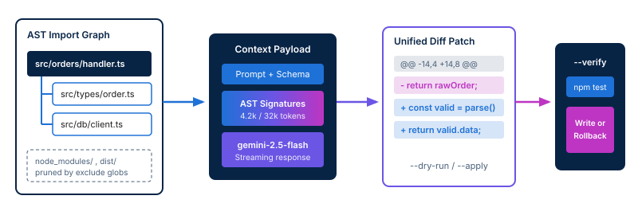

<!-- course-title: Google Antigravity -->
<!-- course-theme: roi-alt-theme -->

<!-- layout: title -->


Google Antigravity

# Chapter 2: Working with the Antigravity CLI

---

# Chapter 2: Objectives

- Execute common command patterns and automate code generation tasks with the Antigravity CLI
- Master core CLI commands, syntax conventions, and option flags
- Generate project code and remove boilerplate using Gemini prompts
- Automate repetitive developer tasks across the development lifecycle
- Observe end-to-end CLI workflows in a live demonstration

---

<!-- layout: navigation -->
# Chapter 2

- **Core CLI Structure and Command Patterns**
- Generating Code and Eliminating Boilerplate
- Automating Routine Development Tasks
- Demo: Accelerating Development Workflows with the Antigravity CLI

---

# Anatomy of an Antigravity CLI Command

- Every Antigravity CLI command follows a predictable verb-target-flags structure that composes cleanly in shell scripts
- Use `--dry-run` to preview proposed unified diffs in the terminal before modifying your working tree

```bash
# General command grammar
ag <command> [target-files-or-globs] [flags]

# Generate a new module with explicit context and preview the diff
ag generate src/routes/orders.ts \
  --context "src/models/order.ts,src/db/client.ts" \
  --model gemini-2.5-flash \
  --prompt "Create REST endpoints for order creation and status lookup" \
  --dry-run
```

> [!TIP]
> Pass `--interactive` (or `-i`) when you want the CLI to ask clarifying questions or let you approve individual diff hunks before writing to disk.

---

<!-- layout: card-layout -->
# Core CLI Command Families

### Code Authoring (`generate`, `edit`)
- `ag generate` creates new source files, schemas, or modules from natural language prompts and reusable project templates.
- `ag edit` applies targeted inline transformations or multi-file refactors to existing code with AST awareness.

### Quality and Diagnostics (`test`, `explain`)
- `ag test` inspects functions and edge cases to scaffold unit or integration test suites matching your test runner.
- `ag explain` traces execution paths, stack traces, or unfamiliar code blocks directly in the terminal.

### Workflow Automation (`run`, `review`)
- `ag run` executes multi-step pipelines defined in `antigravity.yaml`, chaining code edits with shell verification.
- `ag review` inspects staged Git diffs (`git diff --staged`) to catch regressions, security issues, and missing tests.

---

# Essential Option Flags and Context Controls

- Control model selection, context boundaries, and output formatting directly from the command line
- Explicit CLI flags override both environment variables and workspace settings in `antigravity.yaml`

| Flag | Purpose | Example Usage |
| :--- | :--- | :--- |
| `--model`, `-m` | Override the default Gemini model for the current run | `--model gemini-2.5-pro` |
| `--context`, `-c` | Attach specific files or globs to the prompt payload | `--context "src/types/*.ts"` |
| `--dry-run` | Print unified diff to stdout without modifying files | `ag edit src/app.ts --dry-run` |
| `--verify` | Run a test or build command; roll back if it exits non-zero | `--verify "npm test"` |
| `--format` | Emit structured output (`text`, `diff`, `json`) for scripts | `--format json` |

---

<!-- layout: stacked -->
# How the CLI Assembles Context and Applies Diffs

- **AST-aware context pruning**: instead of sending your entire repository, the CLI parses imports from target files and strips paths matching `context.exclude`
- **Unified diff generation**: Gemini returns structured file patches that can be previewed, piped, or validated automatically
- **Verification gate**: when `--verify` is supplied, Antigravity runs your test suite against the patched code and rolls back automatically on failure



---

<!-- layout: 2-column -->
# Piping Standard Input and Shell Composition

### Piping Logs and Diffs into `ag`
- Pipe compiler errors, failing test output, or Git diffs directly via `stdin`
- Combine standard input with `--file` so Gemini sees both the failure trace and the source file

```bash
# Pipe failing test output into ag edit
npm test 2>&1 | ag edit src/auth/jwt.ts \
  --prompt "Fix the token expiration bug"

# Summarize staged changes into a commit message
git diff --staged | ag run commit-msg
```

### Emitting Structured Output to `stdout`
- Use `--format json` or `--format diff` to feed downstream CLI tools like `jq` or `git apply`
- Helpful for headless CI checks and automated code review summaries

```bash
# Export structured review findings as JSON
git diff origin/main | ag review \
  --format json > review-report.json
```

<!-- below-columns -->

> [!NOTE]
> When piping via `stdin`, Antigravity automatically merges the piped stream with the AST context of any target files passed as arguments.

---

<!-- layout: navigation -->
# Chapter 2

- Core CLI Structure and Command Patterns
- **Generating Code and Eliminating Boilerplate**
- Automating Routine Development Tasks
- Demo: Accelerating Development Workflows with the Antigravity CLI

---

# Scaffolding Code from Existing Types and Schemas

- Boilerplate generation is most reliable when anchored to existing type definitions, database schemas, or OpenAPI specs
- Point `ag generate` at your domain types with `--context` so generated handlers, validators, and DTOs match your exact interfaces

```bash
# Generate a typed Express controller and Zod validator anchored to an existing schema
ag generate src/controllers/invoice.controller.ts \
  --context "src/schemas/invoice.schema.ts,src/middleware/error.ts" \
  --prompt "Generate CRUD controller handlers using InvoiceSchema and standard error middleware"
```

- **Why anchoring works**:
  - Eliminates hallucinated method names and mismatched import paths
  - Adheres to existing error-handling conventions and logging helpers in your repo

---

<!-- layout: 2-column -->
# Ad-Hoc Prompts vs. Project Templates

### Ad-Hoc Prompt Flag (`--prompt`)
- Ideal for one-off transformations or unique business logic
- Written inline on the command line during interactive work
- Risk: developers phrase instructions differently, creating subtle style drift across services

### Reusable Templates (`--template`)
- Stored in `.antigravity/templates/` and committed to version control
- Encapsulates architectural rules, required imports, and naming conventions
- Invoked with `ag generate --template api-route --var entity=payment`

<!-- below-columns -->

> [!IMPORTANT]
> Convert any prompt you run more than three times into a versioned template in `.antigravity/templates/` so the whole team shares the same architectural pattern.

---

# Defining a Reusable Boilerplate Template

- Templates in `.antigravity/templates/` combine parameterized variables, pinned context globs, and system instructions

```yaml
# .antigravity/templates/service-module.yaml
name: service-module
description: Scaffold a domain service with repository injection and error handling
model: gemini-2.5-flash
variables:
  - name: domain
    required: true
context:
  include:
    - "src/core/base-service.ts"
    - "src/core/errors.ts"
prompt: |
  Create a TypeScript service class for the {{domain}} domain extending BaseService.
  Include typed create, getById, and list methods using AppError for not-found cases.
```

```bash
# Invoke the template from the CLI
ag generate src/services/shipping.service.ts --template service-module --var domain=shipping
```

---

<!-- layout: 3-column -->
# Guardrails for Safe Code Generation

### Scope Target Globs
- Pass explicit file paths instead of broad wildcards like `src/**/*`
- Keeps token consumption low and prevents unintended edits to unrelated modules

### Inspect Diffs First
- Run `--dry-run` or `--interactive` when modifying core shared libraries
- Verify imports and edge-case handling before writing changes to disk

### Validate Immediately
- Pair generation commands with `--verify` to run your typechecker or linter
- Example: `--verify "npx tsc --noEmit"` catches type mismatches automatically

---

<!-- layout: navigation -->
# Chapter 2

- Core CLI Structure and Command Patterns
- Generating Code and Eliminating Boilerplate
- **Automating Routine Development Tasks**
- Demo: Accelerating Development Workflows with the Antigravity CLI

---

<!-- layout: card-layout -->
# High-Leverage Tasks to Automate with the CLI

### Unit Test Generation
- Inspect untested branches and edge cases in existing modules with `ag test`.
- Automatically aligns assertions and mocks with Jest, Vitest, or Pytest conventions in your repo.

### Multi-File Refactoring
- Migrate deprecated APIs, rename domain concepts, or convert callbacks to `async/await` across modules.
- Route complex cross-file changes to `gemini-2.5-pro` with `--verify` enabled to guarantee passing tests.

### Pre-Commit Review and Docs
- Run `ag review --staged` before committing to flag leaked secrets, unhandled promises, or missing docstrings.
- Generate changelog entries, OpenAPI specs, and pull request descriptions directly from Git history.

---

# Automating Unit Test Generation and Verification

- Use `ag test` to analyze control flow in a source file, scaffold a matching test file, and execute your test runner in one loop
- Passing `--verify` instructs Antigravity to run the generated test suite and self-correct any syntax or assertion errors

```bash
# Generate unit tests for pricing logic and verify they pass in Vitest
ag test src/billing/discount-calculator.ts \
  --output tests/billing/discount-calculator.test.ts \
  --context "src/billing/types.ts" \
  --prompt "Cover boundary conditions, expired coupon codes, and negative totals" \
  --verify "npx vitest run tests/billing/discount-calculator.test.ts"
```

> [!TIP]
> Include an existing test file in `--context` (for example, `tests/billing/tax.test.ts`) so Gemini mirrors your team’s exact mocking and fixture setup.

---

# Declarative Workflows in antigravity.yaml

- Define repeatable, multi-step workflows under the `workflows:` key in `antigravity.yaml` and execute them with `ag run <workflow-name>`
- Workflows chain code generation, verification commands, and model overrides into a single command

```yaml
# Excerpt from antigravity.yaml
workflows:
  scaffold-endpoint:
    description: Generate route, controller, and verified unit tests
    steps:
      - name: generate-handler
        run: ag generate src/routes/{{name}}.ts --template api-route --var entity={{name}}
      - name: generate-tests
        run: ag test src/routes/{{name}}.ts --output tests/routes/{{name}}.test.ts
      - name: verify-types-and-tests
        shell: npm run typecheck && npx vitest run tests/routes/{{name}}.test.ts
```

---

<!-- layout: 2-column -->
# Integrating CLI Workflows into Git Hooks and CI

### Local Pre-Commit Hook (`.husky/pre-commit`)
- Keep pre-commit checks under a few seconds by routing staged diffs to `gemini-2.5-flash`
- Block commits only on high-severity findings

```bash
#!/usr/bin/env sh
# Run fast AI review on staged changes
git diff --staged | ag review \
  --model gemini-2.5-flash \
  --fail-on high
```

### Headless CI Pipeline Execution
- Always pass `--non-interactive` (or `--yes`) in CI so the runner never hangs waiting for terminal input
- Supply credentials via masked CI secrets (`GEMINI_API_KEY` or Workload Identity)

```bash
# Run automated PR review in CI
ag run pr-audit \
  --non-interactive \
  --format json > pr-audit.json
```

<!-- below-columns -->

> [!CAUTION]
> Never use `--auto-apply` without `--verify` inside an automated CI pipeline. Unverified automated commits can introduce build failures directly into your branch.

---

<!-- layout: navigation -->
# Chapter 2

- Core CLI Structure and Command Patterns
- Generating Code and Eliminating Boilerplate
- Automating Routine Development Tasks
- **Demo: Accelerating Development Workflows with the Antigravity CLI**

---

<!-- layout: card-layout -->
# Demo: Accelerating Workflows with the CLI

### Step 1: Scaffold a Typed Endpoint
- Inspect an existing TypeScript domain model (`src/models/subscription.ts`).
- Run `ag generate` with `--dry-run` to preview the REST handler, then apply the patch.

### Step 2: Generate and Verify Unit Tests
- Run `ag test` against the newly created subscription handler with `--verify` attached to the test runner.
- Watch the CLI generate edge-case tests and immediately execute them to confirm green status.

### Step 3: Pipe a Diff into Automated Review
- Stage the generated files with Git and pipe `git diff --staged` into `ag review`.
- Execute a multi-step `ag run` workflow from `antigravity.yaml` to produce a structured commit summary.

---

# Demo Step 1: Scaffolding Code with Context and Dry-Run

- First, we preview the generated handler using `--dry-run` to inspect how Antigravity uses our domain types, then write the file

```bash
# 1. Inspect the existing domain model
cat src/models/subscription.ts

# 2. Preview generated route handler without modifying disk
ag generate src/routes/subscription.routes.ts \
  --context "src/models/subscription.ts,src/middleware/auth.ts" \
  --prompt "Create Express routes for creating, pausing, and canceling subscriptions" \
  --dry-run

# 3. Apply the generation and typecheck immediately
ag generate src/routes/subscription.routes.ts \
  --context "src/models/subscription.ts,src/middleware/auth.ts" \
  --prompt "Create Express routes for creating, pausing, and canceling subscriptions" \
  --verify "npm run typecheck"
```

---

<!-- layout: 2-column -->
# Demo Step 2 and 3: Automated Testing and Staged Review

### Terminal Commands
```bash
# 4. Generate and verify unit tests
ag test src/routes/subscription.routes.ts \
  --output tests/subscription.routes.test.ts \
  --verify "npx vitest run tests/subscription.routes.test.ts"

# 5. Stage files and run pre-commit AI review
git add src/routes/subscription.routes.ts \
        tests/subscription.routes.test.ts
git diff --staged | ag review \
  --model gemini-2.5-flash

# 6. Generate conventional commit message
git diff --staged | ag run commit-summary
```

### What to Watch For
- `ag test --verify` writes the test suite, invokes `vitest`, and confirms all assertions pass before returning
- `ag review` reads the piped Git diff and checks for missing authentication middleware or unhandled errors
- `ag run commit-summary` outputs a clean, conventional commit message ready for `git commit`

---

# What You Learned

- Executed common command patterns and automated code generation tasks with the Antigravity CLI
- Mastered core CLI commands, syntax conventions, and option flags
- Generated project code and removed boilerplate using Gemini prompts
- Automated repetitive developer tasks across the development lifecycle
- Observed end-to-end CLI workflows in a live demonstration

---

# Quiz 1 of 3

**You want to refactor an authentication middleware file using `ag edit`, and you want Antigravity to automatically revert the changes if your existing unit tests fail. Which CLI flag should you pass?**

- A. `--dry-run`
- B. `--verify "npm test"`
- C. `--format json`
- D. `--context "tests/**/*.spec.ts"`

---

# Quiz 1: Answer

**You want to refactor an authentication middleware file using `ag edit`, and you want Antigravity to automatically revert the changes if your existing unit tests fail. Which CLI flag should you pass?**

**Correct: B.** `--verify "npm test"`

- `--verify` executes the specified shell command immediately after applying the diff and rolls back changes if the command exits with a non-zero status
- `--dry-run` only prints the proposed diff to standard output without writing changes or running tests
- `--format json` controls output serialization for scripts, and `--context` attaches files to the prompt without executing them

---

# Quiz 2 of 3

**Your team notices that when different developers use `ag generate --prompt "..."` to create new microservice endpoints, the generated controllers use inconsistent error handling and logging imports. What is the best way to standardize the output?**

- A. Require everyone to use `gemini-2.5-pro` with `--temperature 1.0`
- B. Disable the Antigravity CLI and write all boilerplate manually
- C. Create a parameterized template in `.antigravity/templates/` with pinned context files and commit it to Git
- D. Pass `--non-interactive` on every developer workstation

---

# Quiz 2: Answer

**Your team notices that when different developers use `ag generate --prompt "..."` to create new microservice endpoints, the generated controllers use inconsistent error handling and logging imports. What is the best way to standardize the output?**

**Correct: C.** Create a parameterized template in `.antigravity/templates/` with pinned context files and commit it to Git

- Templates in `.antigravity/templates/` lock in standard system instructions, required context files (such as shared error and logger modules), and variable placeholders
- Committing templates to version control ensures every developer invokes the exact same pattern via `ag generate --template`
- Raising temperature to `1.0` increases randomness rather than consistency

---

<!-- layout: 2-column -->
# Quiz 3 of 3: Discussion

### Prompt
Your team wants to add Antigravity CLI automation to both your local Git pre-commit hook and your GitHub Actions pull request pipeline.

### Discuss
- Which tasks and Gemini models belong in the local pre-commit hook versus the CI pipeline?
- Which CLI flags are mandatory when running `ag` inside a headless CI job?
- How should you handle code generation versus read-only review in CI?

---

<!-- layout: 2-column -->
# Quiz 3: Discussion Points

**Your team wants to add Antigravity CLI automation to both your local Git pre-commit hook and your GitHub Actions pull request pipeline.**

### Strong Answers Mention
- Using `gemini-2.5-flash` on `git diff --staged` in pre-commit hooks so checks finish in a few seconds
- Reserving deeper multi-file analysis with `gemini-2.5-pro` for asynchronous CI pull request checks
- Passing `--non-interactive` and `--format json` in CI jobs so pipelines never hang on user prompts
- Keeping CI pipelines read-only (`ag review`) or strictly gating any automated edits behind `--verify`

### Watch For
- Running slow, full-repository `gemini-2.5-pro` prompts on every local `git commit`, frustrating developers
- Forgetting `--non-interactive` in CI, causing builds to time out waiting for diff approval
- Auto-committing unverified AI code edits directly on the main branch in CI

---

# Questions and Answers

Questions?
