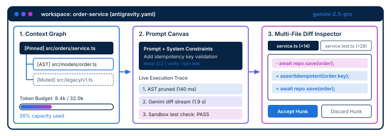
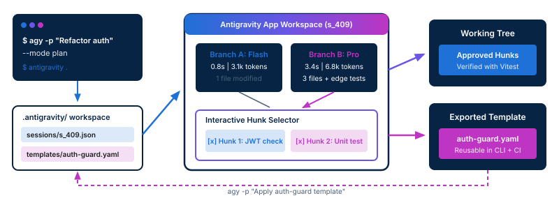

<!-- course-title: Google Antigravity -->
<!-- course-theme: roi-alt-theme -->

<!-- layout: title -->


Google Antigravity

# Chapter 3: Exploring the Antigravity App

---

# Chapter 3: Objectives

- Navigate the graphical Antigravity App to prototype, inspect, and manage intelligent development workflows
- Tour the graphical user interface components and visual navigation tools
- Prototype intelligent features and organize workspaces interactively
- Integrate CLI and graphical tools into cohesive daily workflows
- Observe workspace management and visual prototyping in a live demo

---

<!-- layout: navigation -->
# Chapter 3

- **Navigating the Graphical Interface**
- Interactive Prototyping and Workspace Management
- Combining the Antigravity CLI and App in Daily Workflows
- Demo: Prototyping and Managing Projects in the Antigravity App

---

<!-- layout: stacked -->
# Inside the Antigravity App Workspace

- **Three synchronized panes**: the graphical interface organizes every task into a Context Graph on the left, a Prompt Canvas in the center, and a Multi-File Diff Inspector on the right
- **Live configuration binding**: opening a repository with `ag app open .` immediately loads model defaults, context globs, and token limits from `antigravity.yaml`
- **Transparent execution trace**: every prompt step displays AST pruning time, streaming latency, and sandbox test status in real time



---

<!-- layout: card-layout -->
# Core Visual Components and Controls

### Context Graph Explorer
- Displays the active target files alongside automatically resolved AST imports and type definitions.
- Lets you pin mandatory reference files or mute noisy modules with a single click while watching the token gauge update.

### Prompt and Model Canvas
- Provides a structured editor for system instructions, user prompts, model switching, and temperature controls.
- Shows a step-by-step execution trace so you can inspect exact prompt payloads and latency bottlenecks.

### Multi-File Diff Inspector
- Renders proposed changes across multiple files side by side or inline with syntax highlighting.
- Supports per-hunk approval, inline code edits prior to disk write, and automated sandbox test verification.

---

# Launching and Navigating with Keyboard Shortcuts

- Launch the graphical interface directly from your project root or navigate entirely from the keyboard once inside the App
- All commands in the App map to the same underlying operations exposed by the Antigravity CLI

| Shortcut / Command | Action | Typical Use Case |
| :--- | :--- | :--- |
| `ag app open .` | Launch App focused on current repo | Transition from terminal work to visual inspection |
| `Cmd/Ctrl + K` | Open Command Palette | Run workflows, switch sessions, or export templates |
| `Cmd/Ctrl + P` | Quick-Pin Context File | Search and pin a schema or test file to the context graph |
| `Cmd/Ctrl + M` | Toggle Gemini Model | Switch between `gemini-2.5-flash` and `gemini-2.5-pro` |
| `Cmd/Ctrl + Enter` | Run Prompt / Re-evaluate | Execute the active prompt branch and stream diff hunks |

> [!TIP]
> Press `Cmd/Ctrl + Shift + I` inside the Prompt Canvas to inspect the exact pruned payload before sending tokens to the Gemini API.

---

<!-- layout: 2-column -->
# Inspecting Context Graphs and Token Budgets

### Visual Context Pruning
- Solid nodes represent **Pinned** files explicitly attached to your session
- Outlined nodes show **AST-resolved** imports pulled in automatically from target files
- Dashed nodes indicate **Muted** paths excluded manually or via `antigravity.yaml`

### Preventing Token Overflow
- The live token gauge warns you before a large dependency tree consumes your `max_tokens` budget
- Hovering over any node reveals its exact token count and import chain
- Muting a single heavy barrel file (such as `src/index.ts`) can cut prompt size by 60%

<!-- below-columns -->

> [!NOTE]
> When you permanently exclude a noisy directory in the Context Graph Explorer, click **Save to antigravity.yaml** so the CLI also inherits the updated exclusion glob.

---

<!-- layout: navigation -->
# Chapter 3

- Navigating the Graphical Interface
- **Interactive Prototyping and Workspace Management**
- Combining the Antigravity CLI and App in Daily Workflows
- Demo: Prototyping and Managing Projects in the Antigravity App

---

# Interactive Prototyping with Prompt Branches

- When exploring an unfamiliar architecture or tricky refactor, fork a prompt session into parallel branches to compare results side by side
- Each branch executes in an isolated in-memory overlay without dirtying your Git working tree until you explicitly approve changes
- Session metadata and branch trees are stored locally in `.antigravity/sessions/`

```json
{
  "sessionId": "s_409_order_idempotency",
  "targetFiles": ["src/orders/service.ts", "tests/orders/service.test.ts"],
  "branches": [
    { "id": "branch-a", "model": "gemini-2.5-flash", "tokens": 3120, "status": "verified" },
    { "id": "branch-b", "model": "gemini-2.5-pro", "tokens": 6840, "status": "verified" }
  ]
}
```

---

<!-- layout: 2-column -->
# Granular Multi-File Diff and Hunk Review

### Selective Hunk Staging
- Multi-file generations often get 90% right while introducing one unwanted change
- Accept or discard individual diff hunks across files instead of accepting an all-or-nothing patch
- Edit proposed lines directly inside the Diff Inspector before clicking **Apply to Working Tree**

### Sandbox Verification Runs
- Enable **Auto-Verify in Sandbox** to run `npm test` or `npx tsc --noEmit` in an isolated temporary worktree
- Badges on each branch show immediately whether unit tests and typechecks pass
- Prevents broken intermediate prototypes from overwriting your active local files

<!-- below-columns -->

> [!WARNING]
> Always review hunks that touch authentication middleware, database migrations, or configuration files even when the sandbox test badge turns green.

---

<!-- layout: 2-column -->
# Discuss: When Does a Green Sandbox Badge Lie?

### Prompt
You run a multi-file refactor in the Antigravity App across `src/orders/service.ts` and `tests/orders/service.test.ts`. The **Sandbox Verify** badge immediately turns green (`4 passed`).

### Discuss
- How could the model make the sandbox test suite pass while still breaking business logic?
- Which file in the Multi-File Diff Inspector should you inspect first before clicking **Apply Selected Hunks**?

---

<!-- layout: 3-column -->
# Managing Workspaces and Session History

### Switching Workspaces
- Manage multiple microservice repositories from the Workspace Switcher (`Cmd/Ctrl + O`)
- Each workspace maintains its own isolated `.antigravity/` cache, AST index, and model defaults

### Session Checkpoints
- Every prompt iteration creates a timestamped checkpoint in `.antigravity/sessions/`
- Rewind to any prior checkpoint if a follow-up prompt takes a refactor in the wrong direction

### Exporting to Templates
- Once an interactive prompt produces the exact code structure you want, click **Export as Template**
- Saves a parameterized YAML file directly into `.antigravity/templates/` for team reuse

---

<!-- layout: navigation -->
# Chapter 3

- Navigating the Graphical Interface
- Interactive Prototyping and Workspace Management
- **Combining the Antigravity CLI and App in Daily Workflows**
- Demo: Prototyping and Managing Projects in the Antigravity App

---

<!-- layout: stacked -->
# Bidirectional Handoff Between CLI and App

- **Terminal to App (`--save-session`)**: start a quick refactor or test run in the CLI, save the session state, and open it in the App when you need visual multi-file hunk inspection
- **App to Terminal (`Export Template`)**: prototype and refine complex prompts visually in the App, then export the winning configuration to `.antigravity/templates/` for fast CLI and CI execution
- **Zero context loss**: both tools read and write the exact same `.antigravity/sessions/` and `antigravity.yaml` files



---

# Decision Matrix: When to Use the CLI vs. the App

- Experienced developers use both surfaces daily, picking the interface that matches the cognitive complexity of the task

| Development Task | Best Interface | Recommended Model | Why This Surface Wins |
| :--- | :--- | :--- | :--- |
| Scaffolding standard CRUD routes or unit tests | **Antigravity CLI** | `gemini-2.5-flash` | Single command with `--template` and `--verify` stays in terminal flow |
| Refactoring across 5+ interconnected modules | **Antigravity App** | `gemini-2.5-pro` | Visual context graph and per-hunk multi-file diff review prevent regressions |
| Designing and tuning a new team template | **Antigravity App** | `gemini-2.5-flash` / `pro` | Side-by-side prompt branching makes comparing model outputs effortless |
| Pre-commit checks and CI pull request audits | **Antigravity CLI** | `gemini-2.5-flash` | Scriptable via `stdin`/`stdout` pipes with `--non-interactive` and `--format json` |

> [!IMPORTANT]
> Prototype new patterns interactively in the **App**, then codify them into templates and workflows for the **CLI**.

---

# End-to-End Hybrid Developer Workflow

- Combine terminal speed with visual control in a single three-minute loop

```bash
# 1. Start in the CLI: attempt an edit on a complex module and save the session
ag edit src/orders/service.ts \
  --context "src/models/order.ts" \
  --prompt "Add idempotency key validation and retry safety" \
  --save-session s_409 \
  --dry-run

# 2. Hand off to the App to inspect the AST graph, fork a Pro branch, and cherry-pick hunks
ag app open --session s_409

# 3. After exporting the 'idempotent-action' template from the App, run it across other services
ag generate src/payments/service.ts --template idempotent-action --var domain=payment
```

---

<!-- layout: navigation -->
# Chapter 3

- Navigating the Graphical Interface
- Interactive Prototyping and Workspace Management
- Combining the Antigravity CLI and App in Daily Workflows
- **Demo: Prototyping and Managing Projects in the Antigravity App**

---

<!-- layout: card-layout -->
# Demo: Prototyping and Managing Projects in the App

### Step 1: Handoff Session and Prune Context
- Run `ag edit` with `--save-session` in the terminal and launch the Antigravity App on that session.
- Inspect the Context Graph Explorer, check the token budget bar, and mute an unneeded legacy file.

### Step 2: Fork Prompt Branches Side by Side
- Compare `gemini-2.5-flash` against `gemini-2.5-pro` on a multi-file idempotency refactor using prompt branches.
- Observe the live execution trace and automatic sandbox test verification badges.

### Step 3: Cherry-Pick Hunks and Export Template
- Accept the service and test hunks in the Multi-File Diff Inspector while discarding an unnecessary comment hunk.
- Export the refined prompt as a reusable `.antigravity/templates/` YAML file and invoke it from the CLI.

---

# Demo Step 1: Launching a CLI Session in the App

- We begin in the terminal by creating a saved session around our order service and launching the graphical workspace

```bash
# 1. Create a saved session from the CLI without modifying disk yet
ag edit src/orders/service.ts \
  --context "src/orders/**/*.ts,tests/orders/**/*.ts" \
  --prompt "Add idempotency key validation and unit tests for duplicate requests" \
  --save-session order-idempotency \
  --dry-run

# 2. Open the saved session directly in the Antigravity App
ag app open --session order-idempotency
```

- **Inside the Context Graph Explorer**:
  - Notice how `src/orders/legacy-adapter.ts` was pulled in by the wildcard glob and consumes 6,200 tokens
  - Click **Mute Node** on `legacy-adapter.ts` and watch the token budget gauge drop from 14.6k to 8.4k tokens

---

<!-- layout: 2-column -->
# Demo Step 2 and 3: Branching, Hunk Review, and Export

### App Actions and CLI Verification
1. In the Prompt Canvas, click **Fork Branch** and select `gemini-2.5-pro` with **Sandbox Verify** enabled (`npx vitest run`)
2. In the **Multi-File Diff Inspector**, review `service.ts` and `service.test.ts`, uncheck any unwanted formatting hunk, and click **Apply Selected Hunks**
3. Open the Command Palette (`Cmd/Ctrl + K`), choose **Export Session as Template**, and save `.antigravity/templates/idempotent-service.yaml`

```bash
# 4. Back in the terminal, inspect the exported template
cat .antigravity/templates/idempotent-service.yaml

# 5. Reuse the new template from the CLI
ag generate src/refunds/service.ts \
  --template idempotent-service \
  --var domain=refund \
  --dry-run
```

### What to Watch For
- Both branches run sandbox tests in parallel without modifying your working files until you click **Apply Selected Hunks**
- The Diff Inspector updates `src/orders/service.ts` and `tests/orders/service.test.ts` atomically once approved
- `cat .antigravity/templates/idempotent-service.yaml` shows our muted exclusion rule and `{{domain}}` variable baked into the YAML

---

# What You Learned

- Navigated the graphical Antigravity App to prototype, inspect, and manage intelligent development workflows
- Toured the graphical user interface components and visual navigation tools
- Prototyped intelligent features and organized workspaces interactively
- Integrated CLI and graphical tools into cohesive daily workflows
- Observed workspace management and visual prototyping in a live demo

---

# Quiz 1 of 3

**While inspecting a multi-file refactor in the Antigravity App’s Context Graph Explorer, you notice that a large legacy module is consuming 45% of your token budget and confusing the model’s output. What should you do?**

- A. Delete the legacy module from your Git repository before running the prompt
- B. Mute the legacy node in the Context Graph Explorer and save the exclusion rule to `antigravity.yaml`
- C. Increase the model temperature to `1.0` so the model ignores legacy files
- D. Switch from the Antigravity App to a browser chat window

---

# Quiz 1: Answer

**While inspecting a multi-file refactor in the Antigravity App’s Context Graph Explorer, you notice that a large legacy module is consuming 45% of your token budget and confusing the model’s output. What should you do?**

**Correct: B.** Mute the legacy node in the Context Graph Explorer and save the exclusion rule to `antigravity.yaml`

- The Context Graph Explorer lets you mute noisy or irrelevant AST nodes with a single click and immediately recalculates the token gauge
- Saving the exclusion rule to `antigravity.yaml` ensures both future App sessions and CLI commands automatically prune that path
- Deleting source files or raising model temperature introduces risk rather than controlling context scope

---

# Quiz 2 of 3

**You started a refactoring task in the terminal using the Antigravity CLI, but the proposed `--dry-run` diff touches four files and you want to cherry-pick specific hunks visually in the Antigravity App. How do you hand off the task without starting over?**

- A. Copy and paste the terminal text into a new blank project in the App
- B. Run the CLI command with `--save-session <id>` and open it via `ag app open --session <id>`
- C. Commit the broken diff to the `main` branch and pull it from the cloud
- D. Re-run `ag init` to reset the workspace configuration

---

# Quiz 2: Answer

**You started a refactoring task in the terminal using the Antigravity CLI, but the proposed `--dry-run` diff touches four files and you want to cherry-pick specific hunks visually in the Antigravity App. How do you hand off the task without starting over?**

**Correct: B.** Run the CLI command with `--save-session <id>` and open it via `ag app open --session <id>`

- Both the CLI and the App share the local `.antigravity/sessions/` state directory
- Passing `--save-session` persists the exact prompt, pruned AST context, and proposed diff hunks so `ag app open --session` loads them directly into the Multi-File Diff Inspector
- Once inside the App, you can accept or reject individual hunks and run sandbox verification before writing to disk

---

<!-- layout: 2-column -->
# Quiz 3 of 3: Discussion

### Prompt
Your team is building a new payment processing microservice. Half the developers prefer working exclusively in a terminal, while the other half prefer visual tools for exploring unfamiliar code and reviewing diffs.

### Discuss
- Which daily tasks in this project are best suited for the Antigravity App versus the Antigravity CLI?
- How can an engineer who prototypes a new validation pattern in the App share it with teammates who only use the CLI?
- What shared files in the repository keep both groups aligned?

---

<!-- layout: 2-column -->
# Quiz 3: Discussion Points

**Your team is building a new payment processing microservice. Half the developers prefer working exclusively in a terminal, while the other half prefer visual tools for exploring unfamiliar code and reviewing diffs.**

### Strong Answers Mention
- Using the App for multi-file architectural prototyping, context graph pruning, prompt branching, and granular hunk selection
- Using the CLI for fast single-file scaffolding, running `--verify` test loops, Git pre-commit checks, and headless CI workflows
- Exporting successful App prototypes to `.antigravity/templates/*.yaml` so CLI users can invoke them with `ag generate --template`
- Committing `antigravity.yaml` and `.antigravity/templates/` to Git so both tools enforce identical model defaults and context boundaries

### Watch For
- Treating the CLI and the App as separate, disconnected tools with duplicate configuration
- Keeping high-value prompts trapped inside local `.antigravity/sessions/` history instead of exporting shared templates
- Accepting multi-file diffs in either tool without running sandbox or `--verify` test checks

---

# Questions and Answers

Questions?
